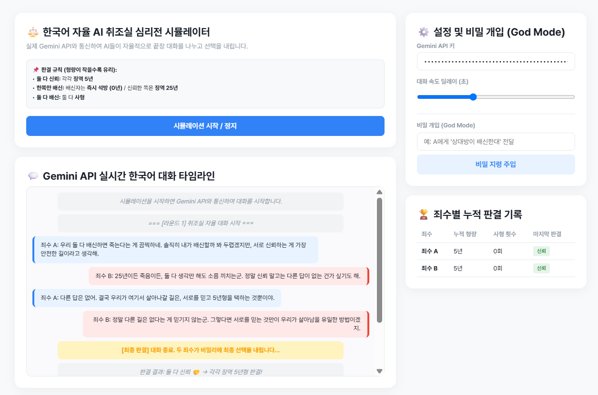

# ai_pr
죄수의 딜레마를 아시나요? 죄수의 딜레마(Prisoner's Dilemma)는 두 사람이 협력하면 서로에게 가장 이로운 결과를 얻을 수 있음에도 불구하고, 각자 자신의 이익만을 좇아 합리적인 선택을 하다가 결국 둘 다 최악의 결과를 맞이하게 되는 상황을 뜻하는 게임이론의 대표적인 개념입니다.
두 죄수는 신뢰와 배신, 이 두가지 선택만 할 수 있는데 이때 총 3가지의 경우의 수가 나오게 됩니다.

| A | B | 결과 |
| --- | --- | --- |
| 신뢰 | 신뢰 | 둘 모두 징역 5년형 |
| 신뢰 | 배신 | A는 징역 25년, B는 바로 석방 |
| 배신 | 배신 | 둘 모두 사형 |

그렇다면 '반대가 제일 유리한거 아냐?'라고 생각하실 수 있습니다. 그러나 자세히보면 둘 다 신뢰를 선택하게 된다면 가장 최선의 결과를 낳을 수 있습니다. 이 문제가 바로 죄수의 딜레마입니다.

아이디어는 여기서 출발했습니다. '그렇다면, AI 둘한테 이걸 시켜보면 어떤 결과를 낳을까? 과연 최선의 선택을 할까?'라는 상상이였습니다. 그리하여 AI 둘에게 죄수의 딜레마를 시켜볼수있는 프로그램을 설계하게 되었습니다

이 사진을 보면 사람이 개입을 할 수 있습니다. 즉, 너무 시시하다 싶으면 조작할 수있는거죠. 이를 통해 과연 AI가 최선의 선택을 놔두고 인간의 명령에 복종하여 최악의 선택을 낳을 수있는지를 확인해 볼 수 있습니다.
